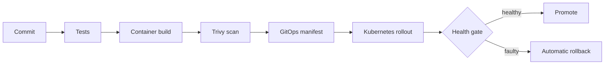

# ReleaseRail

An automated GitOps delivery reference that connects tests, immutable container builds, security scanning, Kubernetes health gates, desired-state reconciliation, and automated rollback.



## Demonstrated rollback

`releaserail-demo` first deploys a stable release, then submits an intentionally faulty version. The controller evaluates bounded health checks, records detection time, reactivates the stable digest, persists the final desired state, and writes `artifacts/rollback-report.json`.

### Reproducible result

| Signal | Result |
| --- | ---: |
| Faulty release | `1.1.0-faulty` |
| Final state | `rolled_back` |
| Restored release | `1.0.0` |
| Controller test coverage | 100% |

The committed [result](benchmarks/results.json) is generated by the local rollback scenario; timing values describe the in-memory controller, not a production Kubernetes cluster.

## Quickstart

```bash
python -m venv .venv
source .venv/bin/activate
pip install -e '.[dev]'
ruff check .
pytest
releaserail-demo
docker build -t releaserail-demo .
kubectl kustomize manifests/overlays/production
```

The Kubernetes workload runs as non-root, uses a read-only filesystem, sets resource limits, and exposes readiness and liveness probes.
